# N-xport Data Tool — Technical Overview

This document explains how the N-xport data export, import, and migration tool works under the hood: its architecture, how connections are established, the data collection and export pipeline, CSV import, the migration system, and how the GUI and backend communicate.

---

## Table of Contents

- [Architecture Overview](#architecture-overview)
- [Connection & Session Lifecycle](#connection--session-lifecycle)
- [Authentication & Token Management](#authentication--token-management)
- [API Client & Rate Limiting](#api-client--rate-limiting)
- [Data Models](#data-models)
- [Export Execution Flow](#export-execution-flow)
- [Import Execution Flow](#import-execution-flow)
- [Migration Execution Flow](#migration-execution-flow)
- [Command-Line Tool](#command-line-tool)
- [Testing and CI](#testing-and-ci)
- [Export Formats & File Output](#export-formats--file-output)
- [GUI-Backend Communication (IPC)](#gui-backend-communication-ipc)
- [Profile & Credential Management](#profile--credential-management)
- [Error Handling & Resilience](#error-handling--resilience)
- [Security Considerations](#security-considerations)
- [Key Architectural Decisions](#key-architectural-decisions)

---

## Architecture Overview

The tool is composed of two layers: a React frontend rendered inside a Tauri desktop shell, and a Rust backend that handles all API communication, data processing, and file I/O.

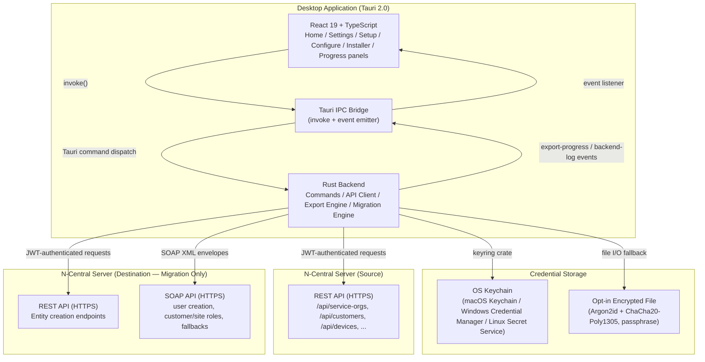

### Tech Stack

| Layer | Technology |
|-------|-----------|
| **Frontend** | React 19.1, TypeScript 5.8, Vite 7.0, CSS (dark theme) |
| **Desktop Shell** | Tauri 2.0 (Rust), tauri-plugin-dialog, tauri-plugin-fs, tauri-plugin-opener, tauri-plugin-updater, tauri-plugin-process |
| **Backend** | Rust (Edition 2021), Tokio async runtime, Reqwest (rustls TLS), Serde |
| **Data Export** | csv crate (RFC 4180), serde_json (pretty-printed) |
| **Credentials** | keyring crate (OS keychain); opt-in passphrase-encrypted file (argon2, chacha20poly1305, zeroize) |
| **CLI** | Clap 4.x (derive macros), rpassword (no-echo passphrase prompts) |
| **Logging** | tracing + tracing-subscriber |
| **Target** | N-central API-Service REST API per the checked-in OpenAPI spec (`docs/api/n-central-openapi-spec.json`, spec version 1.0); SOAP for user creation and as a fallback (see below) |

---

## Connection & Session Lifecycle

Every export or migration begins with establishing an authenticated connection to at least one N-Central server. The connection flow validates credentials and retrieves server metadata before any data operations begin.

### Single-Server Connection (Export Mode)

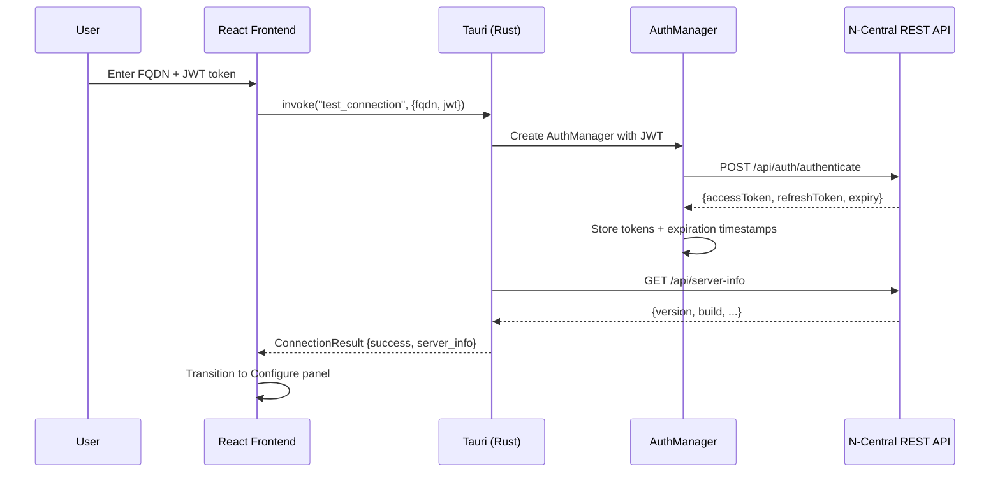

### Dual-Server Connection (Migration Mode)

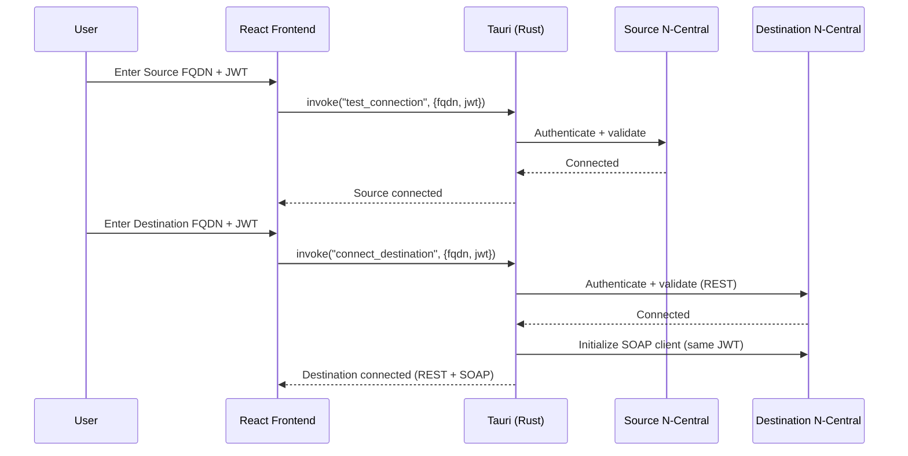

**Key details:**

- **Connecting replaces the previous connection.** `test_connection` and `connect_destination` first clear whatever was connected on that side (REST client, SOAP client, and, for the source, the cached import lookups) and only then connect. A failed attempt therefore leaves that side disconnected rather than silently still connected to the previous server. `disconnect` clears both sides. The frontend disconnects and resets its displayed state before connecting a different profile.

- **HTTPS only.** The FQDN is normalized to `https://`; an `http://` prefix is replaced, so the JWT is never sent in clear text.

- **Server address**: whatever is typed or pasted (with or without `https://` or `http://`, a trailing slash or page path, surrounding spaces, any letter case) is reduced to `https://<host>` by `server_url` in `commands/connection.rs`; the app, the CLI and saved profiles all use it, so connections are always HTTPS.
- **JWT authentication**: The user provides a pre-generated JWT API token from their N-Central instance. This token is exchanged for a short-lived access token and a refresh token via the `/api/auth/authenticate` endpoint.

- **Connection validation**: After authentication, the tool fetches `/api/server-info` to verify the server is reachable and running a compatible N-Central version.

- **Dual-client state**: `AppState` holds a REST `NcClient` and an `NcSoapClient` for the source and for the destination, each with independent authentication. A SOAP client is created for every connected server, using the API username (SOAP authenticates with username plus the JWT as password).

---

## Authentication & Token Management

The `AuthManager` (`src-tauri/src/api/auth.rs`) handles the full JWT token lifecycle with automatic refresh.

### Token Storage

```rust
pub struct AuthManager {
    state: Arc<RwLock<Option<AuthState>>>,  // None until authenticated; thread-safe interior mutability
    base_url: String,
    http: reqwest::Client,
}

pub struct AuthState {
    pub access_token: String,
    pub refresh_token: String,
    pub access_expires_at: DateTime<Utc>,
    pub refresh_expires_at: DateTime<Utc>,
}
```

### Token Refresh Flow

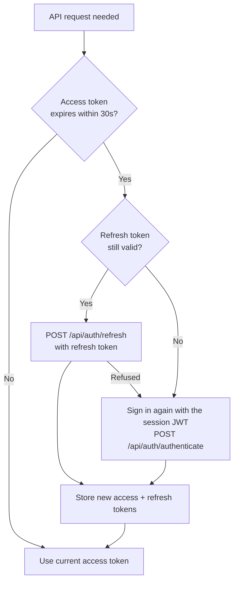

**Key details:**

- **30-second buffer**: Token refresh is triggered 30 seconds before the access token actually expires, preventing mid-request expiration.
- **Thread safety**: `Arc<RwLock<Option<AuthState>>>` allows concurrent reads (for normal API calls) with exclusive writes (during token refresh). The read lock is released before any refresh request is made.
- **Long runs**: the JWT the session was opened with is kept in memory only (zeroized when dropped, never logged or written) so that when the refresh token expires, or is refused, the manager signs in again instead of failing every remaining request. One task renews at a time (`refresh_lock`); concurrent requests reuse its result, which also stops two tasks from refreshing at once.
- **401/403 handling**: A 401 or 403 response is reported as an authentication error; the client does not retry it. Refreshing happens before each request (via `get_token`), not in response to a failure, so a token that expires between that check and the request surfaces as an error the user can retry.

---

## API Client & Rate Limiting

### NcClient Architecture

The `NcClient` (`src-tauri/src/api/client.rs`) is the central HTTP client for all N-Central REST API interactions.

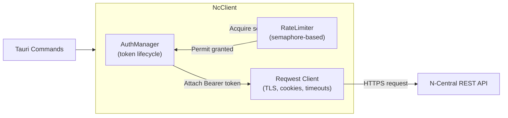

### Request Pipeline

Every API call follows this pipeline:

1. **Rate limit acquisition**: Acquire a semaphore permit for the endpoint category (blocks if at capacity)
2. **Token validation**: Check if the access token needs refresh; refresh if necessary
3. **Request construction**: Build the request with Bearer token, JSON content type, and any query parameters
4. **Response handling**: Parse the response, handling pagination if the endpoint returns paginated data
5. **Error recovery**: On 429 (rate limited) or 5xx (server error), retry with exponential backoff
6. **Semaphore release**: Release the rate limit permit (automatic via RAII)

### Rate Limiter

The `RateLimiter` (`src-tauri/src/api/rate_limiter.rs`) uses Tokio semaphores to enforce per-endpoint concurrency limits:

| Endpoint Category | Concurrent Limit | Examples |
|-------------------|-----------------|----------|
| **Authentication** | 50 | `/api/auth/authenticate`, `/api/auth/refresh` |
| **List (paginated)** | 5 | `/api/customers`, `/api/devices`, `/api/users` |
| **Single resource** | 50 | `/api/devices/{id}`, `/api/customers/{id}` |
| **Properties** | 5 | `/api/org-units/{id}/custom-properties` |

**Path normalization**: Parameterized routes (e.g., `/api/devices/12345/assets`) are normalized to `/api/devices/{id}/assets` before matching, so all requests to the same endpoint type share a single concurrency pool.

### Retry Strategy

| Error Type | Retry Behavior |
|-----------|---------------|
| **429 (Rate Limited)** | Wait per `Retry-After` header (capped at 60 seconds), up to 3 retries |
| **500, 502, 503, 504 (Server Error)** | Exponential backoff of 1s, 2s, then 4s (capped at 16s), up to 3 retries; other 5xx responses are not retried |
| **401/403 (Auth)** | Reported as an authentication error; no retry (the token is refreshed proactively before each request) |
| **Timeout, dropped connection** | 60-second per-request timeout. Reads (GET) that fail without an HTTP response are retried with the same 1s, 2s, 4s backoff, up to 3 times; writes are never retried, because repeating a create after a timeout could duplicate it |

### Mocked API Coverage

The Rust library tests run the REST client against a local mock HTTP server. They cover JWT authentication, paginated results with alternate metadata shapes and empty/final partial pages, documented pagination query parameters, 429 retry exhaustion, retry of a dropped read but not of a write, token refresh and re-sign-in (including concurrent callers), authentication/not-found/invalid-response errors, and the custom-property PUT path and body. Run them with `cd src-tauri && cargo test --all-targets`. These tests complement, but do not replace, validation against a representative N-central server. See [Testing and CI](#testing-and-ci) for the full test and CI picture.

### Pagination

All list endpoints return paginated responses. The client automatically iterates all pages:

```
Page 1: GET /api/customers?pageNumber=1&pageSize=100
Page 2: GET /api/customers?pageNumber=2&pageSize=100
...
Page N: GET /api/customers?pageNumber=N&pageSize=100
```

The `PaginatedResponse<T>` wrapper extracts `PageInfo` (total pages, total items) from each response. The client does not assume the server honours the page size it asked for: N-central can cap it (the OpenAPI spec mentions a configured maximum), and the spec documents only `totalItems` on list responses. So it never decides it is finished from the requested page size. It stops when:

- a page comes back empty;
- the items collected reach the reported `totalItems`;
- the reported `totalPages` is reached;
- with no totals at all, a page is shorter than the first one;
- a page is identical to the previous one, meaning the endpoint ignores page numbers (for example `/api/devices/{id}/custom-properties`, which the spec does not paginate). This guard also prevents an endless loop.

Tests run these cases against a mock server that really pages a dataset: a capped page size with each combination of totals, no totals, an exact multiple of the page size, empty and single-item results, and an endpoint that ignores paging.

---

## Data Models

All data models are defined in `src-tauri/src/models/` and use Serde for serialization and deserialization. The models map to the N-Central REST API response structures.

### Organization Hierarchy

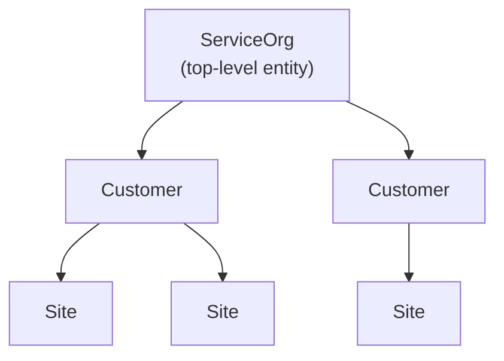

| Model | Key Fields | API Source |
|-------|-----------|-----------|
| `ServiceOrg` | id, name, parent_id | `/api/service-orgs` |
| `Customer` | id, name, parent_id, service_org_id | `/api/customers` |
| `Site` | id, name, parent_id, customer_id | `/api/sites` (under customers) |

### Device & Asset Models

| Model | Key Fields | API Source |
|-------|-----------|-----------|
| `Device` | id, name, org_unit_id, device_class, local check-in time, aggregate status | `/api/devices` |
| `DeviceAsset` | Categorized asset data and response links in the `data` envelope | `/api/devices/{id}/assets` |
| `DeviceProperty` | property_id, label, value | `/api/devices/{id}/custom-properties` |

The asset endpoint returns a dynamic category map rather than a fixed hardware object. JSON retains the complete category map and response links; the CSV export maps known fields to its hardware columns and uses the requested device ID because the response may omit `deviceId`. Device aggregate status is represented as nested fields in JSON and flattened into `deviceStatusState` and `deviceStatusStatus` in CSV.

List responses use `data` with pagination metadata that can include `pageNumber`, `pageSize`, and `totalItems` or `totalPages`. The client accepts these fields when present and continues fetching pages until the reported total is reached. Custom-property labels accept the API's `propertyName` field.

Scope filtering includes SO, customer, and site IDs for devices. Site ownership accepts the documented camelCase fields and legacy alternate parent-link fields, including snake_case `service_orgid`.

### User & Access Models

| Model | Key Fields | API Source |
|-------|-----------|-----------|
| `User` | id, email, username, role_ids, access_group_ids, is_enabled | `/api/users` |
| `UserRole` | id, name, permission names, user IDs, role flags | `/api/user-roles` |
| `AccessGroup` | id, name, member IDs/usernames, org-unit/device IDs, auto-include flag | `/api/access-groups` |

Role and access-group models accept documented boolean fields and retain their org-unit scope, group type, membership IDs, and permissions in exports. Property exports preserve enumerated values as arrays in JSON and delimited values in CSV. User boolean flags and arrays that are optional in the OpenAPI schema default safely when omitted.

Role-creation requests encode permission IDs as strings, and organization access-group requests encode IDs and `autoIncludeNewOrgUnits` in the string forms declared by the OpenAPI request schemas. Device-based access-group import/migration is not attempted because device ID mapping is not implemented; imports reject those rows and migrations report manual follow-up.

Create-request routes carry the parent customer/service-org/org-unit ID in the path, so customer and site request bodies intentionally omit `parentId`/`customerId`. Customer and site `licenseType` remains unset because it is not part of the current import template. Service-org/customer/site IDs accepted as either strings or numbers from API responses are normalized to integers in the exported JSON; custom-property names serialize using the API's `propertyName` key.

### Custom Properties

| Model | Key Fields | API Source |
|-------|-----------|-----------|
| `OrgProperty` | property_id, label, value, org_unit_id | `/api/org-units/{id}/custom-properties` |

### Serialization Helpers

The `common.rs` module provides custom serialization functions for handling API inconsistencies:

| Helper | Purpose |
|--------|---------|
| `string_or_i64()` | Deserialize fields that may be returned as either string or integer |
| `option_string_or_i64()` | Optional variant of above |
| `option_bool_or_string()` | Deserialize optional booleans returned as booleans or legacy strings |
| `serialize_vec_to_string()` | Serialize `Vec<T>` as semicolon-separated string for CSV export |
| `serialize_opt_vec_to_string()` | Optional variant of above |

---

## Export Execution Flow

The export system is the core functionality of N-xport. It fetches data from a source N-Central server and writes it to CSV and/or JSON files.

### End-to-End Flow

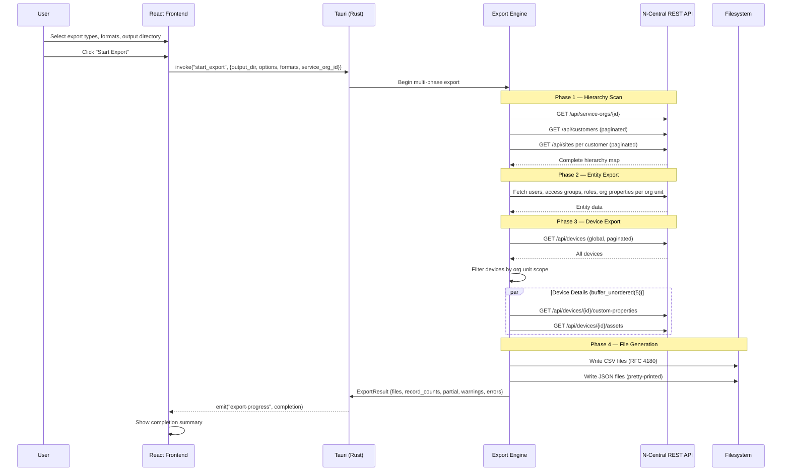

### Multi-Phase Export Pipeline

The export runs in four phases, each emitting progress events to the UI:

`ExportResult.totalRecords` counts logical records written across the selected resource types. Each record is counted once even when both CSV and JSON are selected; it is not the combined number of rows across output files.

An export with fetch warnings or output errors is marked `partial` and identified as a partial export in the completion panel. The panel shows warning/error counts and up to five details; the activity log contains the full issue list. A run with no output and errors is reported as failed rather than successful.

**Phase 1 — Hierarchy Scan (0-10%)**

Builds the complete organizational tree starting from the specified Service Organization ID:

1. Fetch the Service Organization details
2. Fetch all Customers under the SO (paginated)
3. For each Customer, fetch all Sites (paginated)
4. Build a flat list of all org unit IDs for scoping subsequent queries

**Phase 2 — Entity Export (10-60%)**

For each org unit in the hierarchy, fetch:

- **Users**: Deduplicated by user ID (users can appear under multiple org units)
- **Access Groups**: With member usernames and org unit scope
- **User Roles**: With permission name mappings
- **Organization Properties**: Custom property key-value pairs

Each entity type is fetched iteratively across all org units, with caching to avoid duplicate API calls.

**Phase 3 — Device Export (60-90%)**

1. Fetch all devices globally (paginated)
2. Filter to devices within the scoped org units
3. For each in-scope device (concurrently, up to 5 at a time via `buffer_unordered(5)`):
   - Fetch custom properties (if selected)
   - Fetch hardware assets (if selected)

**Phase 4 — File Generation (90-100%)**

Write all collected data to the selected export formats (CSV, JSON, or both) in the specified output directory.

### Cancellation

The `AppState` contains an `AtomicBool` cancellation token shared by export, import, and migration. When the user clicks **Cancel**, the frontend calls `invoke("cancel_export")` and the backend sets the token. Operations check it between phases and at safe work boundaries, including device fetches and import/migration rows. In-flight API calls are allowed to finish; no further work is started after the next cancellation check. Completed export files and destination changes are retained. Each command returns a distinct `cancelled` result instead of reporting success.

---

## Import Execution Flow

CSV files are read with any leading UTF-8 byte order mark removed (Excel's "CSV UTF-8" adds one, which would otherwise be glued to the first header name). CSV import writes to the **source-connected** server (the one connected in the first slot). It lives in `src-tauri/src/import/` (row models, templates, per-resource handlers) and `src-tauri/src/commands/import.rs` (`start_import`, `generate_template`, `get_import_types`).

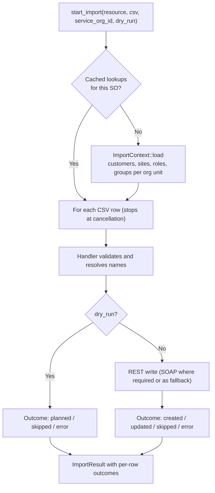

**Supported resources**: customers, sites, access groups, user roles, users, organization property values, device property values. Service organizations, devices, and device assets are listed as unsupported and rejected by the backend.

**Name lookups (`ImportContext`)**: Rows refer to other entities by name, so the handler context holds customer, site, role, and access-group lookups for the target service org. Roles and groups are stored **per org unit** as the roles/groups visible there (its own plus those inherited from the service org), because a same-named role at a sibling customer is a different role. Org units that are not loaded individually (sites) fall back to a global first-seen lookup. The context is cached on `AppState` so a dry-run followed by the real run does not rebuild it; the cache is cleared whenever the source connection is replaced or dropped, because it holds IDs from that one server.

**Duplicates and repeated runs**: A row whose entity already exists (at that org unit or inherited) is *skipped*. Entities created during the run are added to the context, including ones the server created but returned no ID for, so repeated rows in one file or a re-run create nothing twice. Users created in the session are remembered by login and org unit; a server refusal (`userAdd` returning -1) is treated as "already exists" and skipped, not as an error.

**Property values**: Existing definitions are matched by name (unique match required; missing and ambiguous matches are row errors). Enumerated values are validated against the definition. Writes use the documented `PUT .../custom-properties/{propertyId}` endpoints and are safe to repeat; rows apply in file order, so the last row for the same property wins.

**SOAP use**: Users require SOAP `userAdd` (a generated password meeting the configured password policy is used). Customers and access groups fall back to SOAP only if the REST create fails. Customer- or site-level roles try SOAP first and fall back to REST. Everything else is REST only, and a dry run never contacts SOAP. Access-group creation returns 204 with no body, so the new group's ID is looked up by name in the org unit's group list.

**Result**: `ImportResult` carries counts and a per-row outcome list; it is reported as successful only if no row errored and the run was not cancelled.

---

## Migration Execution Flow

The migration system transfers configuration data from a source N-Central server to a destination server. It creates entities on the destination while maintaining ID mappings for cross-references. Each step has its own module under `src-tauri/src/commands/migration/`; the preflight summary is in `migration_preflight.rs`.

### Migration Architecture

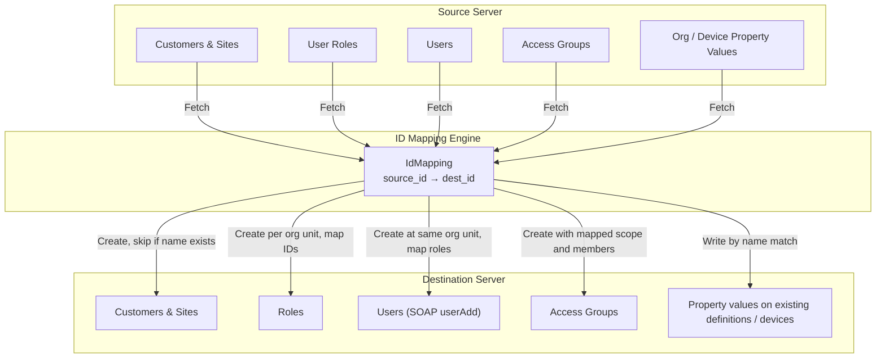

### Preflight

Before a run, the Configure screen calls `migration_preflight(options, source_so_id, dest_so_id)`. It is a pure function of the selection (no server calls) and returns the steps in execution order, whether each uses SOAP (`none`, `fallback`, `preferred`, or `required`), selection warnings, **prerequisites** (what must already exist on the destination before the run: organization and device property definitions, and the devices themselves for device properties, since neither definitions nor devices can be created through the API), and the manual follow-up that is already known (for example, that existing access groups cannot be updated, or that new groups get no members when Users is not selected). The UI renders it, and shows the SOAP prerequisite notice when any step may use SOAP.

### Shared environment

Each step takes a `MigrationEnv` (source and destination clients, the service-org pair, the destination SOAP client if any, the app handle for progress/log events, and the cancel token) plus the `IdMapping` and a `MigrationSummary` that accumulates outcomes.

### ID Mapping Structure

```
IdMapping {
    customers:      HashMap<i64, i64>,      // source customer ID → dest customer ID
    sites:          HashMap<i64, i64>,      // source site ID → dest site ID
    org_units:      HashMap<i64, i64>,      // any source org unit (SO, customer, site) → dest
    roles:          HashMap<i64, i64>,      // source role ID → dest role ID
    role_names:     HashMap<String, i64>,   // lowercase role name → dest role ID (fallback)
    access_groups:  HashMap<i64, i64>,      // source group ID → dest group ID
    user_logins:    HashMap<String, i64>,   // lowercase login → dest user ID
    access_group_members: HashMap<i64, Vec<i64>>, // source group ID → dest user IDs to include
}
```

### Migration Steps

Steps run in this order; the order matters because later steps use earlier mappings.

| Step | Entity | Method | Matching / deduplication |
|------|--------|--------|--------------------------|
| 1 | **Customers & Sites** | REST POST (customers concurrently, `buffer_unordered(2)`); SOAP `customerAdd` only if REST fails | Skip if the name already exists under the mapped parent. Two source sites differing only by case map to one destination site. If Customers is not selected but a later step is, existing destination customers and sites are matched by unique name instead (read-only); unmatched or ambiguous ones are reported and skipped with everything beneath them |
| 2 | **User Roles** | SO-level over REST; customer/site-level via SOAP `userRoleAdd` first, falling back to REST (on N-central 2026.4 REST places customer-level roles correctly; older servers were reported to place them at the service-org level), then a re-fetch to learn the ID | Compared **per destination org unit** (own plus inherited); a same-named role at a sibling customer is a different role |
| 3 | **Users** | SOAP `userAdd` (no REST equivalent), created at the same org-unit level as on the source | Skipped if the login already exists anywhere in the mapped org units. Roles are resolved against the roles the destination actually lists at the user's org unit; any source role that cannot be resolved is reported (not just when all fail) |
| 4 | **Access Groups** | REST POST with mapped org-unit scope and the destination user IDs from step 3 (the source scope and auto-include setting come from the group detail endpoint, because the per-org-unit list omits them; the new group's ID is looked up by name because creation returns no body); SOAP `accessGroupAdd` only if REST fails | Compared per destination org unit. Existing groups are left unchanged (N-central cannot change membership). Source org units with no destination match are dropped from the scope and reported; a group with none is not created. A group created by the SOAP fallback has no members or scope and is flagged for manual completion. Device-based groups are not migrated |
| 5 | **Org Properties** | Values are listed per org unit (the list carries no org-unit ID), so the step walks service org, customers, then sites top-down and writes REST PUT to the matching destination definition; SOAP only if REST fails | Definitions matched by name at the destination org unit; a value the destination already shows (including one a customer only inherits from its parent) is not rewritten, so only real overrides are written; a missing definition is reported once, since definitions cannot be created through the API |
| 6 | **Device Properties** | REST PUT, existing devices only | Devices matched by unique long name within the mapped org unit |

### Property prerequisites

Custom property *definitions* cannot be created through the N-central API, and devices come from agents registering with a server, so migration and import write values only. Organization property values need a destination definition with the same name at the org unit; device property values additionally need the device to be present on the destination (matched by unique long name in the mapped org unit). Anything missing is reported rather than created: a missing definition is reported once per property with the instruction to create it and run again, devices not yet on the destination are listed individually plus a single summary line saying to install or register their agents, and import rows report the same causes as row errors. The preflight lists these under `prerequisites` so they are visible before the run.

### Inherited items

N-central lists a role or access group at every org unit beneath the one that defines it, with the same ID. Migration visits each source role and group once, at the first (highest) org unit that lists it, so an inherited item is evaluated once rather than once per org unit. Access groups defined outside the source service org (inherited from above it) have no destination to map to and are skipped with a note. An existing destination group is reported for follow-up only when a migrated user is missing from it, which is checked against the group's detail record.

### Migration Outcomes

`start_migration` returns `success`, `cancelled`, `issues`, `skipped`, and `manualFollowUp`. Failures and lookup-fetch errors are included in `issues`; existing resources are reported separately in `skipped`; limitations requiring operator action are listed in `manualFollowUp` (for example users created without a role, existing access groups left unchanged, groups created without members because Users was not selected). A run with any failures or manual follow-up is not reported as fully successful, and a repeat run that only skips existing items is. Cancellation is reported separately and preserves changes already completed on the destination.

### SOAP in migration

SOAP is attempted only where it is required (user creation), preferred (customer/site-level roles, with a REST fallback), or after a REST failure for customers, access groups, and organization properties. Sites, device properties, and all reads never use SOAP. When SOAP is missing or disabled, user creation fails visibly and is counted in `issues`; a failed REST write with no SOAP leaves the item in `issues`.

**SOAP client details** (`src-tauri/src/api/soap_client.rs`):

- XML SOAP 1.1 envelopes (`ei2` namespace) posted to `/dms2/services2/ServerEI2`
- Authenticates with the API username and the JWT as the password
- 120-second timeout (longer than REST to accommodate SOAP processing)
- New users get a generated strong password and are marked must-change-on-login; the password is not recorded or logged. Migration does not currently pass the configured password policy (import does)

---

## Export Formats & File Output

### CSV Export

- **Standard**: RFC 4180 compliant via the `csv` crate
- **Encoding**: UTF-8
- **Array fields**: Serialized as semicolon-separated strings (e.g., `role1;role2;role3`)
- **Headers**: Derived from struct field names (snake_case)
- **Directory**: Created automatically if it doesn't exist

### JSON Export

- **Format**: Pretty-printed by default (indented), with compact option available
- **Structure**: Array of objects, one per record
- **Nested objects**: Complex types (e.g., DeviceAsset sub-types) are preserved as nested JSON
- **Field names**: Match the original API response field names

### Output Files

| Export Type | Filename | Content |
|-------------|----------|---------|
| Service Organizations | `service_orgs.csv/json` | SO hierarchy details |
| Customers | `customers.csv/json` | All customers under the SO |
| Sites | `sites.csv/json` | All sites under customers |
| Devices | `devices.csv/json` | Device inventory with classification |
| Users | `users.csv/json` | User accounts, roles, access groups |
| Access Groups | `access_groups.csv/json` | Group definitions and membership |
| User Roles | `user_roles.csv/json` | Role definitions and permissions |
| Org Properties | `org_properties.csv/json` | Custom property key-value pairs |
| Device Properties | `device_properties.csv/json` | Per-device custom properties |
| Device Assets | `device_assets.csv/json` | Hardware details (CPU, RAM, disk, etc.) |
| Registration Tokens | `registration_tokens.csv/json` | Agent registration token and expiry for every customer and site (one row each, with its customer; off by default; export only) |

Note on registration tokens: they come from `GET /api/org-units/{id}/registration-token`, one request per customer and site (service organizations have none). A token that cannot be read becomes a warning and the rest are still written. The file contains live secrets that let agents register, so treat it as sensitive; on macOS and Linux it is written readable only by the current user. The option is not offered for migration, since each server issues its own tokens.

Note on access groups and user roles: they are exported once for each org unit that lists them. N-central lists a role or group at every org unit beneath the one that defines it, so inherited items repeat (a service org with 30 customers lists each inherited role about 31 times), and their member lists can differ by org unit, so the repeats are not pure duplicates. The users export is de-duplicated by user ID.

### Installer scripts

`commands/installers.rs` turns registration tokens into Windows agent installer scripts, one per customer or site, as the peer sample script does for customers. For each selected target it calls `GET /api/org-units/{id}/registration-token` (five at a time, sharing `fetch_tokens` with the registration token export), fills `data/install_agent.ps1.template`, and writes the result to a new `N-central Installer Scripts - <host> - <time>` folder. Customers and sites use the same installer arguments: the org unit's ID as `CUSTOMERID` with its own token.

Safety rules, all tested: the server must be HTTPS on port 443 with a plain host name (the installer arguments assume 443); the token must be GUID-like characters only; names are escaped for a PowerShell single-quoted string, including the curly single quotes PowerShell also treats as quotes, and line breaks become spaces; file names avoid reserved characters and device names and include the org unit ID so equal names never collide; files are created readable only by the current user on macOS and Linux. A test parses every generated script with `pwsh` (skipped when it is not installed) using hostile names. Tokens are never put in warnings or the activity log. A target with no token, an unreadable token, or a write failure is a warning and the rest are still written; an expired token is a warning but its script is still written.

---

## GUI-Backend Communication (IPC)

The desktop GUI uses Tauri's built-in IPC mechanism: the React frontend invokes Rust commands, and the Rust backend emits events back to the frontend.

### IPC Architecture

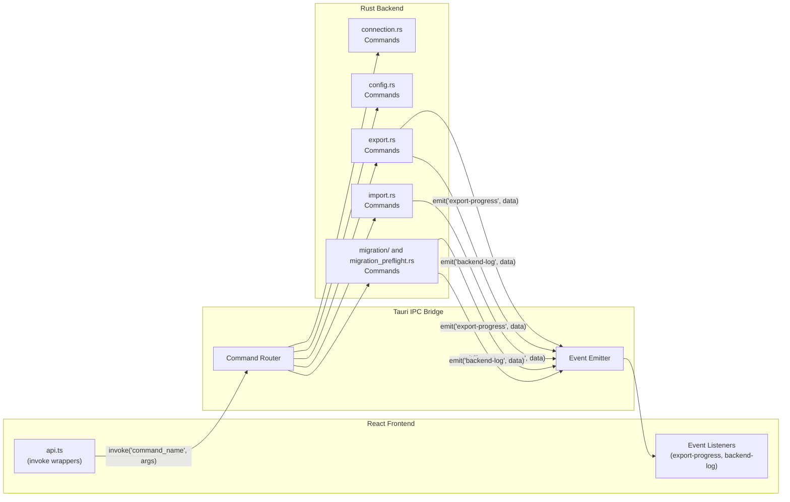

### Progress Events

During export and migration, the backend emits real-time progress updates:

**ProgressUpdate structure**:

```json
{
  "phase": "Exporting devices",
  "message": "Fetching device properties",
  "percent": 65,
  "current": 42,
  "total": 108
}
```

**LogMessage structure**:

```json
{
  "level": "info",
  "message": "Exported 108 devices to CSV"
}
```

Log levels: `info`, `success`, `warning`, `error`, `debug`

### Tauri Commands

The full set of commands exposed by the Rust backend:

| Category | Command | Purpose |
|----------|---------|---------|
| **Connection** | `test_connection(fqdn, jwt, username?)` | Validate server connection |
| | `connect_with_profile(profile_name, fqdn, username?)` | Connect using saved credentials |
| | `connect_destination(fqdn, jwt, username?)` | Setup destination server (migration) |
| | `disconnect()` | Clear source and destination clients and the import lookup cache |
| | `get_service_org_info(service_org_id)` | Fetch SO details |
| | `list_service_orgs()` | List the service orgs the connected user can see (feeds the service-org picker) |
| **Credentials** | `save_credentials(profile_name, jwt, password?)` | Store to the keychain, the encrypted file (if on and unlocked), or the session only; returns `{storage, warning}` |
| | `has_credentials(profile_name)` | Check if stored in any store; works while the encrypted file is locked |
| | `get_credentials(profile_name)` | Retrieve JWT |
| | `get_password(profile_name)` | Retrieve optional password |
| | `delete_credentials(profile_name)` | Remove source and destination JWT and password from every store; errors if any copy remains |
| | `get_credential_storage_status()` / `enable_disk_credentials(passphrase)` / `unlock_credentials(passphrase)` / `lock_credentials()` / `disable_disk_credentials(delete_file)` | The opt-in encrypted credential file |
| **Config** | `get_settings()` | Load settings.json |
| | `save_settings(settings)` | Write settings.json |
| | `get_profiles()` / `save_profile()` / `delete_profile()` | Profile CRUD |
| | `set_active_profile(name)` / `get_active_profile()` | Active profile |
| **Export** | `start_export(output_dir, options, formats, service_org_id)` | Begin export |
| | `get_export_types()` | List available data types |
| | `cancel_export()` | Request cancellation of the running export, import, or migration |
| | `open_directory(path)` | Open export folder in OS file manager |
| **Import** | `start_import(resource_type, csv_path, service_org_id, dry_run, password_policy?)` | Run or dry-run a CSV import |
| | `generate_template(resource_type, path)` | Write a CSV template |
| | `get_import_types()` | List resource types and whether each is supported |
| **Installer scripts** | `list_installer_targets(service_org_id)` | List the customers and sites that can get a script |
| | `generate_installer_scripts(output_dir, targets)` | Fetch each target's registration token and write one Windows installer script per target into a new folder |
| **Migration** | `start_migration(options, source_so_id, dest_so_id)` | Begin migration |
| | `migration_preflight(options, source_so_id, dest_so_id)` | Describe a migration (steps, SOAP use, known follow-up) without contacting either server |

### AppState (Shared Mutable State)

```rust
pub struct AppState {
    pub client: Arc<Mutex<Option<NcClient>>>,                 // Source REST client
    pub source_soap_client: Arc<Mutex<Option<NcSoapClient>>>, // Source SOAP client (import)
    pub dest_client: Arc<Mutex<Option<NcClient>>>,            // Destination REST client
    pub dest_soap_client: Arc<Mutex<Option<NcSoapClient>>>,   // Destination SOAP client (migration)
    pub cancel_token: Arc<AtomicBool>,                        // Cancellation flag
    pub import_context_cache: Arc<Mutex<Option<CachedImportContext>>>, // Import name lookups
}
```

All fields use `Arc<Mutex<>>` for thread-safe access from multiple async Tauri command handlers. The `cancel_token` uses `AtomicBool` for lock-free cancellation signaling. `clear_source()` drops the source clients and the import cache together (the cache holds IDs from that server and must not outlive the connection); `clear_destination()` drops the destination clients.

---

## Profile & Credential Management

### Saved Profiles

Connection profiles store reusable server configurations. Each profile contains:

```
Profile {
    name: String,           // Display name (e.g., "Production", "Staging")
    profile_type: String,   // "export" or "migration"
    source: ConnectionConfig {
        fqdn: String,
        username: Option<String>,
        service_org_id: Option<i64>,
    },
    destination: Option<ConnectionConfig>,  // Only for migration profiles
    last_used: Option<DateTime>,
}
```

### Application Settings

Settings are persisted as JSON in the platform-specific config directory (via the `directories` crate):

| Platform | Path |
|----------|------|
| **macOS** | `~/Library/Application Support/com.fraziersystems.nc-data-export/settings.json` |
| **Windows** | `%APPDATA%\fraziersystems\nc-data-export\config\settings.json` |
| **Linux** | `~/.config/nc-data-export/settings.json` |

Settings include: profiles list, active profile, export directory, export formats, window state (size, position, maximized), the saved password-complexity policy for user imports, and `allowDiskCredentials` (the opt-in for the encrypted credential file). The macOS path was confirmed on a real machine; the Windows and Linux paths follow the `directories` crate's documented layout for this organization and application name and have not been checked on those systems.

The encrypted credential file (`credentials.vault.json`) lives in the user data directory beside it: the same folder on macOS, `~/.local/share/nc-data-export/` on Linux, and `%APPDATA%\fraziersystems\nc-data-export\data\` on Windows. These locations come from the app identifier and directory names, which is why they must not be renamed (see Key Architectural Decisions).

### Credential Storage

Credentials are managed by `CredentialStore` (`src-tauri/src/credentials/keyring.rs`) with three tiers. The keychain is reached through a small `SecretBackend` trait so the fallback logic is tested against a fake keychain.

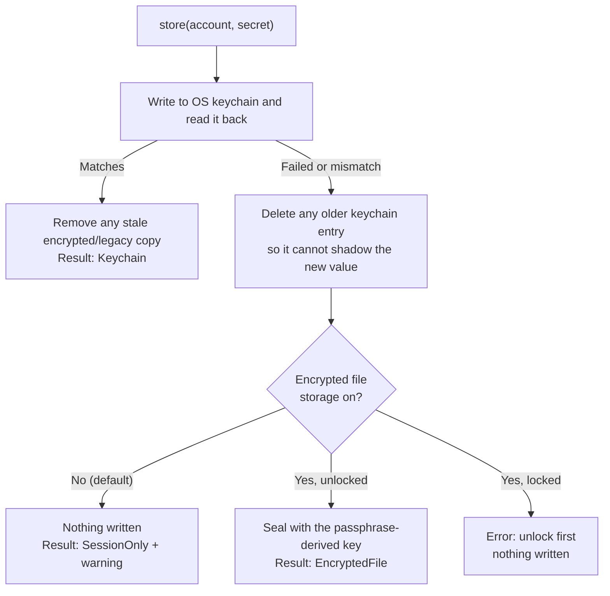

**1. OS keychain** (always tried first):

| Platform | Backend |
|----------|---------|
| macOS | Keychain Services |
| Windows | Credential Manager |
| Linux | Secret Service (GNOME Keyring, KWallet) |

**2. Encrypted file (opt-in)**: off by default. When the keychain is unavailable and nothing else is chosen, **nothing is written to disk**: the credential is kept for the current session only and the user is warned (`StorageBackend::SessionOnly`). A user can opt in to an encrypted file (`allowDiskCredentials` in `settings.json`; the Credential storage card on the Settings page, or `nc-export profile enable-encrypted-storage`). The file, `credentials.vault.json` in the user data directory (`src-tauri/src/credentials/vault.rs`), is protected by a passphrase the user chooses (at least 12 characters, no recovery):

- The key is derived with **Argon2id** (19 MiB, 2 iterations, 1 lane, 16-byte random salt per file); the cost settings are stored in the file, so it still opens if the defaults change.
- Each secret is sealed with **ChaCha20-Poly1305** under a fresh random 96-bit nonce, with the account name as associated data, so an entry cannot be moved to another account and any tampering fails authentication.
- A sealed check value distinguishes a wrong passphrase from a damaged file before anything is written; a failed unlock never modifies the file.
- The file is written atomically (temp file and rename) and, on Unix, readable only by the current user. Account (profile) names are visible; only secrets are sealed.
- The passphrase lives in memory only (zeroed on drop) for the session: after a restart the file is *locked* until it is entered again. Existence checks (`has_credentials`) and deletes work while locked; reads do not.
- Turning the option off keeps the file but makes it unreadable; deleting it is also how a forgotten passphrase is reset.

**3. Legacy file (read-only)**: earlier versions wrote `credentials.json`, XOR-obfuscated with a constant key, which protects nothing against anyone who can read the file. It is never written now. On startup its entries move into the keychain when it works; otherwise they stay readable (so nothing is lost) and the Settings page warns until encrypted file storage is turned on, which re-encrypts them into the vault. The file is deleted once empty.

**Reads** try the keychain, then the encrypted file (if on and unlocked), then the legacy file. **Deletes** remove every copy and fail if any could not be removed, rather than reporting success while a secret remains. Deleting a profile removes four accounts: `{profile}`, `{profile}_password`, `{profile}_dest`, and `{profile}_dest_password`.

**Commands**: `get_credential_storage_status`, `enable_disk_credentials(passphrase)`, `unlock_credentials(passphrase)`, `lock_credentials`, `disable_disk_credentials(deleteFile)`. The CLI prompts for the passphrase without echo, or reads `NC_CREDENTIALS_PASSPHRASE` for scripts (the environment is readable by the user's other processes, so the prompt is preferred).

**Storage keys**:
- JWT token: stored under key `{profile_name}`
- Password (optional): stored under key `{profile_name}_password`
- Destination credentials use the same scheme with the profile name `{profile_name}_dest`

**Verification**: After writing to the keychain, the store reads the value back; a mismatch is treated as keychain failure.

---

## Error Handling & Resilience

### Error Type Hierarchy

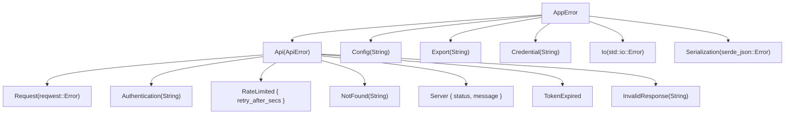

Both `AppError` and `ApiError` implement `Display` and serialize as strings for Tauri IPC transport. The `thiserror` crate provides ergonomic error type definitions.

### Export Error Resilience

The export pipeline is designed to produce partial results rather than fail completely:

- **Per-entity errors**: If fetching a specific device's properties fails, the error is logged as a warning and the export continues with the remaining devices
- **Per-type errors**: If an entire entity type fails (e.g., all user fetches error), the warning is recorded and other entity types continue
- **Warnings collection**: All non-fatal errors are collected into a warnings list and returned in the `ExportResult`
- **Final report**: The completion summary distinguishes complete, partial, failed, and cancelled runs, and shows total records, files, warning/error counts, and representative issue details

---

## Security Considerations

### TLS / HTTPS

- All API communication uses HTTPS with a minimum of TLS 1.2
- The Reqwest client is configured with `rustls` (a pure-Rust TLS implementation) — no OpenSSL dependency
- The Tauri CSP policy allows `connect-src 'self' https://*` — only HTTPS connections are permitted
- The server address is normalized to `https://`; an `http://` prefix is upgraded, never honored

### Credential Handling

- **JWT tokens**: Stored in the OS keychain (encrypted by the OS). If the keychain is unavailable, nothing is written to disk by default: the credential lasts for the session and the user is warned. A user can opt in to a file encrypted with a passphrase (Argon2id key derivation, ChaCha20-Poly1305); see Credential Storage.
- **Tokens in memory**: Held in `Arc<RwLock<>>` for the duration of the session, cleared on disconnect
- **No logging of secrets**: JWT tokens and passwords are never written to logs
- **Credential verification**: A keychain write is read back; a keychain that does not return the value is treated as unavailable
- **Deletion**: Removing a profile removes its source and destination secrets from the keychain, the encrypted file, and any legacy file, and reports any that could not be removed

### Token Expiration

- Access tokens are short-lived and automatically refreshed 30 seconds before expiry
- Refresh token expiration is tracked — when it expires the session signs in again with the in-memory JWT; only if that is missing does the user have to reconnect
- The `AuthManager` prevents stale tokens from being used in API requests

### Rate Limiting

- Per-endpoint semaphore-based concurrency control prevents overwhelming the N-Central API
- 429 responses are handled gracefully with `Retry-After` header compliance
- Exponential backoff on server errors prevents retry storms

### Input Handling

- All API responses are deserialized through strongly-typed Serde models — no raw string interpolation
- File paths for export are validated and parent directories are created safely
- The Tauri security model restricts frontend access to only the registered command set

---

## Command-Line Tool

`nc-export` (`src-tauri/src/bin/nc_export.rs`, runner in `src-tauri/src/cli/`) is a second front end over the same library as the app, for scripted exports and profile management. It is built from source (`cargo build --release --bin nc-export`) and is not part of the installers.

- **Commands**: `test` (check a connection), `export` (one service org: `--all` or any of `--service-orgs`, `--customers`, `--sites`, `--devices`, `--access-groups`, `--user-roles`, `--org-properties`; `-f csv`/`-f json`; `-o` output directory), and `profile` (`list`, `add`, `delete`, `use`, `set-credentials`, `enable-encrypted-storage`, `disable-encrypted-storage`, `storage-status`).
- **Connection**: `--server` with a JWT from `--jwt` or `NC_JWT`, or `--profile` to use a saved profile and its stored credentials. At startup it applies the saved credential-storage opt-in and migrates credentials out of the legacy file (the same `init_credential_storage` the app runs), and it prompts for the encrypted-file passphrase when a command needs a credential held there (or reads `NC_CREDENTIALS_PASSPHRASE`).
- **Shared code**: it reuses the REST client, models, credential store, export writers, and the app's scoping helpers (`site_is_in_scope`, `get_scoped_devices`) and flattened device CSV rows, so sites and devices are limited to the named service org and CSV output has the same shape as the app's.
- **Limits compared with the app**: no import or migration; no users, device assets, or device properties (`--device-properties` prints a notice); access groups, user roles, and organization properties are read for the service org itself rather than every customer and site beneath it; and `--service-orgs` lists every service org the token can see. It has no progress events or cancellation.

---

## Testing and CI

**Rust tests** (`cd src-tauri && cargo test --all-targets`) need no live server:

- **Fake N-central server** (`src-tauri/src/test_support.rs`): a stateful local HTTP server (REST and SOAP) that records requests and answers from per-test state. Import handlers and migration steps are generic over the Tauri `Runtime`, so tests pass a mock app handle (`tauri` is a dev-dependency with the `test` feature).
- **API client**: authentication, token refresh and re-sign-in, pagination behaviour (page-size caps, missing totals, endpoints that ignore paging), 429 retry exhaustion, dropped-connection retry, error mapping, and the custom-property PUT.
- **Import and migration**: repeated and duplicate rows, per-org-unit role/group scoping, mapping validation (role IDs, group scope, partial role loss), SOAP behavior (REST-only paths never call SOAP, fallback only after a REST failure, SOAP missing or disabled fails visibly), the preflight summary, and cancellation.
- **Credentials and connections**: the three storage tiers against a fake keychain, the encrypted file (round trip, wrong passphrase, tampering, swapped entries, atomic writes, permissions), legacy migration, and connection state clearing (including failed connects against an unreachable host).

These complement, but do not replace, validation against a representative N-central server. Real keychain behavior and the packaged installers are not covered by automated tests and need checking on real machines.

**CI** (`.github/workflows/ci.yml`, on pushes to `main` and pull requests, Ubuntu): `./scripts/bump-version.sh --check` (the version files agree), `tsc --noEmit`, `npm test`, and `npm run build` for the frontend; `cargo fmt --check`, `cargo clippy --all-targets --all-features -- -D warnings`, and `cargo test --all-targets` for Rust. Formatting is enforced and Clippy warnings are errors, with no blanket allows. Releases are built separately by `release.yml` on version tags: a verify job (version files agree, tag equals `v` plus the app version), the same checks as CI (it calls `ci.yml`), then the creation of a draft release, the four platform builds (all on GitHub-hosted runners; Linux on `ubuntu-22.04`, which CI also uses so it tests the environment the release builds on) uploading to that draft, and finally a publish job that runs only if every build succeeded and `latest.json` lists macOS (both architectures), Linux, and Windows. A failed platform build therefore leaves an unpublished draft, never a release missing files.

**Live tests** (ignored by default) run against a real server and need `NC_LIVE_BASE_URL` and `NC_LIVE_JWT_FILE` (a file holding the JWT, never printed). The read-only ones (`NC_LIVE_SO_ID`) issue only GET requests: the client and models, the exporter's CSV/JSON shapes, and import dry-runs. The write tests create real objects, and the REST API has no delete, so they refuse to run unless `NC_LIVE_WRITE_SO_ID`'s name equals `NC_LIVE_WRITE_SO_NAME`, and every write goes through the import handlers with a context loaded for that one service org. They cover customer/site creation and repeats, property value round trips (restored afterward), customer-level role placement over REST and SOAP, access groups, and SOAP user creation.

```bash
cd src-tauri

# Read-only: needs NC_LIVE_BASE_URL, NC_LIVE_JWT_FILE, NC_LIVE_SO_ID
cargo test --test live_readonly -- --ignored --nocapture
cargo test --lib live_records -- --ignored --nocapture
cargo test --lib dry_run_rows_resolve -- --ignored --nocapture

# Writes: also needs NC_LIVE_WRITE_SO_ID, NC_LIVE_WRITE_SO_NAME and, for the SOAP steps, NC_LIVE_API_USERNAME
cargo test --lib live_write_tests -- --ignored --nocapture --test-threads=1

# Full migration between two servers: needs NC_LIVE_SRC_URL / _JWT_FILE / _SO_ID / _SO_NAME,
# the same four with NC_LIVE_DST_, and NC_LIVE_DST_API_USERNAME. NC_LIVE_MIGRATE_ONLY
# (for example "users,roles") limits the steps. It refuses to run unless both service-org names match.
cargo test --lib full_migration_between -- --ignored --nocapture
```

The REST API has no delete, so anything the write and migration tests create stays on the server; use a disposable service org.

**Frontend tests** (`npm test`, Vitest with Testing Library in jsdom; `src/**/*.test.tsx`) render the real `App` with the Tauri backend replaced by `mockIPC` (`src/test/backend.ts`), which records every command the UI invokes so tests can assert what was asked of the backend and in what order. Covered: connecting (success and failure), export type/format selection and partial results, import dry-run then apply (and no apply offer when nothing was planned), the SOAP notice per import resource, the migration preflight panel (request contents, step order, prerequisites, SOAP notice, selection warnings, load failure), the property-prerequisites notice, the credential storage card (passphrase validation, unlock, lock, turn off, confirmed delete, legacy-file warning), cancellation, and profile switching (previous connections dropped first, destination and connection state cleared, saved SOAP username passed, profile kept when its credentials cannot be deleted). They check UI behavior against a mocked backend, not the backend itself, and do not render the Tauri shell.

---

## Key Architectural Decisions

### Tauri over Electron

The tool uses **Tauri 2.0** instead of Electron for the desktop shell. This provides:

- Significantly smaller binary size (Tauri apps are typically 5-10MB vs 100MB+ for Electron)
- Lower memory footprint (no bundled Chromium)
- Native OS integration (system keychain, file dialogs, auto-updater)
- Rust backend for performance-critical operations (API calls, data processing, file I/O)

### Rust Backend for API Communication

All N-Central API communication happens in Rust rather than in the frontend. This provides:

- **Connection pooling**: Reqwest maintains persistent connections
- **Concurrent rate limiting**: Tokio semaphores enable precise concurrency control
- **Token management**: Thread-safe token refresh and re-sign-in without frontend involvement
- **File I/O**: Direct filesystem access without browser sandbox limitations

### REST-First with SOAP Where Required

The N-Central REST API is the primary integration point. SOAP is **required** for user creation, and **preferred** for customer- or site-level user roles (REST also places them correctly on N-central 2026.4, verified live; older servers were reported to place them at the service-org level). Customers, access groups, and organization-property writes use REST first and fall back to SOAP only if the REST call fails. Exports, site creation, device properties, and dry runs never use SOAP. N-central has SOAP APIs disabled by default, so the migration preflight and the import screen show a reminder when a selected operation can call SOAP, and SOAP-dependent work fails visibly when SOAP is unavailable. Organization-property values use the documented `PUT /api/org-units/{orgUnitId}/custom-properties/{propertyId}` REST endpoint first. A SOAP client exists for every connected server; there is no setting to forbid SOAP.

### Import and Migration Scope

Service-organization import and device-record creation are out of scope. Creating a device record is distinct from deploying its agent; N-xport does not deploy agents. Organization and device custom-property values can be imported and migrated by matching existing definitions by name. Device-property import requires an existing device identified by its long name within an explicitly selected customer/site scope; device-property migration requires unique source/destination device-name matches within mapped org units. Property IDs are resolved independently on each server, and missing or ambiguous matches are reported rather than guessed. Enumerated values are validated against the target definition when available. A blank CSV `value` is an explicit request to clear the property. The full device hardware/software asset inventory is read-only and remains export-only; asset lifecycle writes are also out of scope for now. Supported N-Central versions are not certified: read operations, export, and import dry-runs have been checked against one N-central 2026.4.0.25 demo server, and write operations have not yet been verified on a live server.

### Concurrent Device Detail Fetching

Device properties and assets are fetched per-device (the API doesn't support bulk fetching). To keep this performant, the export uses `buffer_unordered(5)` — up to 5 device detail requests run concurrently. This balances throughput against API rate limits.

### Name-Based Deduplication

During import and migration, entities are matched by **name** rather than ID, within the right org-unit scope: customers under the service org, sites under their customer, roles and access groups at the target org unit (own or inherited), users by login. A match is skipped rather than duplicated, and entities created during a run are remembered, so repeating an import file or a migration creates nothing new and a repeat run that only skips existing items is reported as a success. Property values are written with repeat-safe PUTs.

### No Session Persistence

Export and migration state is not persisted between sessions. If the application is closed mid-operation, progress is lost and the operation must be restarted. This simplifies the architecture by avoiding checkpoint/resume logic, and is acceptable because most exports complete within a few minutes.

### Auto-Update Distribution

The application uses Tauri's built-in updater plugin with GitHub Releases as the update source. When a new version is published:

1. The app checks for updates on launch (via `useUpdateChecker`)
2. If an update is available, a banner is displayed
3. The user can choose to install the update
4. The updater downloads the platform-specific installer and applies it

**Distribution targets** (built by `.github/workflows/release.yml`; not yet smoke-tested per platform):

| Platform | Format |
|----------|--------|
| macOS | `.dmg`, built separately for Apple Silicon and Intel |
| Windows | `.msi` installer (the bundler targets `all`, so other Windows formats may also be produced) |
| Linux | `.deb` and `.AppImage` (the bundler targets `all`) |

---

## Frontend Component Architecture

### React Component Tree

```
App.tsx (state management, event listeners, workflow orchestration)
├── HomePanel.tsx                 — Welcome screen, mode selection (export / import / migrate), Generate Installer Scripts, Settings entry
├── SettingsPanel.tsx             — Settings page
│   └── CredentialStorageCard.tsx — Where credentials are kept; opt in to, unlock, lock, or delete the encrypted file
├── PageHead.tsx                  — Title, hint and step indicator at the top of each workflow page
├── SetupPanel.tsx                — Server connection form, credential entry, profile selection (and CSV templates in import mode)
│   └── ImportTemplatesMenu.tsx   — CSV template download menu (also used by ImportPanel)
├── InstallerPanel.tsx            — Customers and sites (sites nested under their customer) to generate installer scripts for
├── ConfigurePanel.tsx            — Export/migration type selection, formats, output directory
│   └── MigrationPreflightPanel.tsx — Preflight summary (steps, SOAP use, known follow-up) in migrate mode
├── ImportPanel.tsx               — Resource, CSV template/file, dry-run toggle (shows SoapApiNotice and PropertyPrerequisitesNotice where they apply)
├── ProgressPanel.tsx             — Real-time progress bar, activity log, cancel button, results
├── ServiceOrgCombobox.tsx        — Service-org picker
├── NewProfileModal.tsx           — Profile creation dialog
└── UpdateBanner                  — Auto-update notification (via useUpdateChecker)
```

### Workflow State Machine

```
    ┌──────────┐   mode selected   ┌───────────┐   connected    ┌─────────────┐
    │   HOME   │ ───────────────── │   SETUP   │ ────────────── │  CONFIGURE  │
    └──────────┘                   └───────────┘                └─────────────┘
                                                                       │
                                                                  start export
                                                                       │
    ┌──────────┐   view results    ┌─────────────┐   running    ┌─────────────┐
    │ COMPLETE │ ◄──────────────── │  EXPORTING  │ ◄──────────── │  CONFIGURE  │
    └──────────┘                   └─────────────┘              └─────────────┘
         │                                │
         │         cancel / error         │
         └────────────────────────────────┘
```

Import and migration follow the same path: SETUP → CONFIGURE → the running step (shown as Dry-running, Importing, or Migrating) → COMPLETE. The Credential storage card lives on the Settings page, opened from the gear icon on the home screen. A run cannot be left or the connection dropped until it finishes or is cancelled.

### Type Definitions

The frontend type system (`src/types.ts`) mirrors the Rust backend structures:

| Type | Purpose |
|------|---------|
| `Profile` | Saved connection profile |
| `ConnectionConfig` | Server FQDN + credentials |
| `Settings` | Application preferences |
| `ExportOptions` | Selected data types for export |
| `ExportResult` | Export completion summary |
| `ProgressUpdate` | Real-time progress event |
| `LogEntry` | Activity log message |
| `ExportType` | Available export data types |
| `ConnectionStatus` | Connection state enum |
| `MigrationOptions`, `MigrationResult` | What to migrate, and the result (issues, skipped, manual follow-up) |
| `MigrationPreflight` | Preflight summary: steps, SOAP use, prerequisites, warnings, known follow-up |
| `ImportResult`, `ImportRowOutcome` | Import summary and per-row outcomes |
| `SaveCredentialsResult`, `CredentialStorageStatus` | Where a credential was saved, and the state of the encrypted credential file |
| `PasswordPolicy` | Password complexity for generated user passwords |

### API Wrapper

`src/api.ts` provides thin, type-safe wrappers around Tauri's `invoke()` function. Each wrapper maps to a single Tauri command:

```typescript
// Example: type-safe command invocation
export async function startExport(
    outputDir: string,
    options: ExportOptions,
    formats: string[],
    serviceOrgId: number
): Promise<ExportResult> {
    return invoke("start_export", { outputDir, options, formats, serviceOrgId });
}
```

---

## Key Source Files

| File | Purpose |
|------|---------|
| `src-tauri/src/lib.rs` | Tauri app initialization, plugin registration, command handler registration |
| `src-tauri/src/main.rs` | Platform entry point (Windows subsystem config) |
| `src-tauri/src/api/client.rs` | `NcClient` — async REST API client with pagination & retry |
| `src-tauri/src/api/auth.rs` | `AuthManager` — JWT token lifecycle & automatic refresh |
| `src-tauri/src/api/endpoints.rs` | API path constants & endpoint builders |
| `src-tauri/src/api/rate_limiter.rs` | Semaphore-based per-endpoint concurrency control |
| `src-tauri/src/api/soap_client.rs` | `NcSoapClient` — SOAP for user creation, customer/site roles, and fallbacks |
| `src-tauri/src/models/*.rs` | Serde data models (ServiceOrg, Customer, Device, User, etc.) |
| `src-tauri/src/models/common.rs` | Serialization helpers for API inconsistencies |
| `src-tauri/src/commands/connection.rs` | Connection & credential Tauri commands, `AppState` definition |
| `src-tauri/src/commands/config.rs` | Settings & profile Tauri commands |
| `src-tauri/src/commands/export.rs` | Multi-phase export orchestration logic |
| `src-tauri/src/commands/migration/` | Multi-step migration, one module per step: `run.rs` (orchestration and the Tauri command), `customers.rs`, `roles.rs`, `users.rs`, `access_groups.rs`, `properties.rs`, plus `types.rs` (`IdMapping`, options and result), `env.rs` (`MigrationEnv`, progress and logging helpers), `summary.rs` (`MigrationSummary`), and `mapping.rs` (pure ID-resolution helpers); tests in `tests/` |
| `src-tauri/src/commands/migration_preflight.rs` | Pure preflight summary for a migration selection |
| `src-tauri/src/commands/import.rs` | `start_import`, templates, import types |
| `src-tauri/src/commands/installers.rs` | Windows installer script generation: target listing, template filling and escaping, safe file names, script writing; tests in `installers/tests.rs`, including a PowerShell parse of every generated script |
| `src-tauri/data/install_agent.ps1.template` | The installer script template (adapted from Morgan Rourke's sample; placeholders for server, ID, name and token) |
| `src-tauri/src/import/handlers/` | Per-resource import handlers (`customers.rs`, `sites.rs`, `access_groups.rs`, `roles.rs`, `users.rs`, `properties.rs`) and the `ImportContext` lookups (`context.rs`); tests in `tests/` |
| `src-tauri/src/import/mod.rs` | CSV row models, templates, outcome types |
| `src-tauri/src/test_support.rs` | Stateful fake N-central server for tests |
| `src-tauri/data/rolePermissionIds.csv` | The one bundled role permission list (name to ID, including aliases); `PermissionLookup::bundled()` loads it |
| `src-tauri/src/export/csv.rs` | CSV file writer (RFC 4180) |
| `src-tauri/src/export/json.rs` | JSON file writer (pretty-printed) |
| `src-tauri/src/config/settings.rs` | Settings persistence & profile management |
| `src-tauri/src/credentials/keyring.rs` | Keychain-first credential store: opt-in encrypted file, session-only otherwise, legacy-file migration |
| `src-tauri/src/credentials/vault.rs` | Passphrase-encrypted credential file (Argon2id + ChaCha20-Poly1305) |
| `src-tauri/src/commands/credential_storage.rs` | Commands for the encrypted-file opt-in, unlock, lock, and status |
| `src/components/CredentialStorageCard.tsx` | Credential storage card, shown on the Settings page |
| `src/components/SettingsPanel.tsx` | Settings page (credential storage) |
| `src/components/PageHead.tsx` | Page title, hint, and the Setup / Configure / Run step indicator |
| `src/components/InstallerPanel.tsx` | Customer and site picker for installer scripts, with sites nested under their customer |
| `src/components/ImportTemplatesMenu.tsx` | CSV template download menu, on the Setup and Configure pages for import |
| `src-tauri/src/error.rs` | `AppError` & `ApiError` type definitions |
| `src/App.tsx` | React main component — state management & workflow orchestration |
| `src/api.ts` | Type-safe Tauri command wrappers |
| `src/types.ts` | TypeScript interface definitions |
| `src/components/HomePanel.tsx` | Welcome screen & mode selection |
| `src/components/SetupPanel.tsx` | Connection form & profile management |
| `src/components/ConfigurePanel.tsx` | Export/migration configuration UI |
| `src/components/MigrationPreflightPanel.tsx` | Migration preflight summary |
| `src/components/ImportPanel.tsx` | CSV import UI |
| `src/components/ProgressPanel.tsx` | Real-time progress display |
| `src-tauri/Cargo.toml` | Rust dependencies |
| `src-tauri/tauri.conf.json` | Tauri app configuration (window, CSP, updater, bundler) |
| `package.json` | Node.js dependencies & build scripts |
| `vite.config.ts` | Vite build configuration (React plugin, Tauri dev host) |
